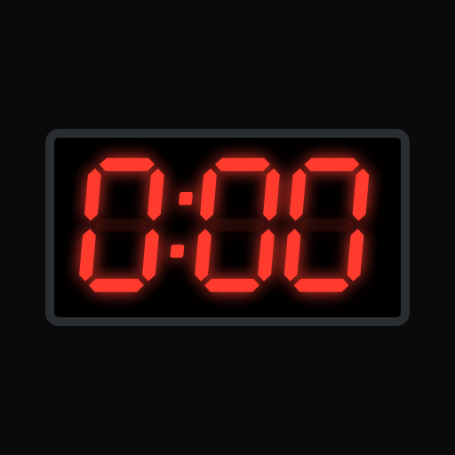
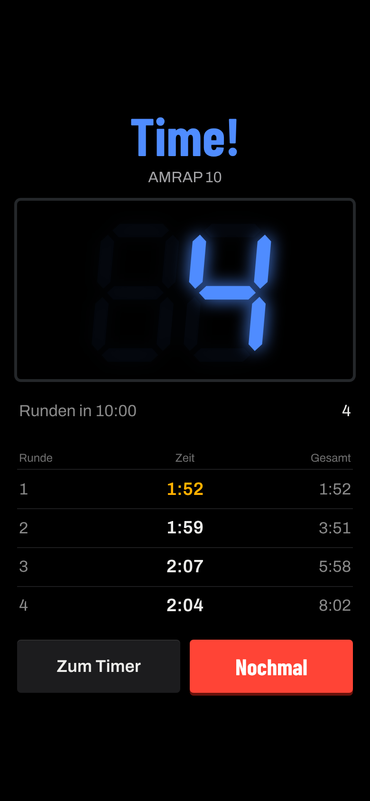
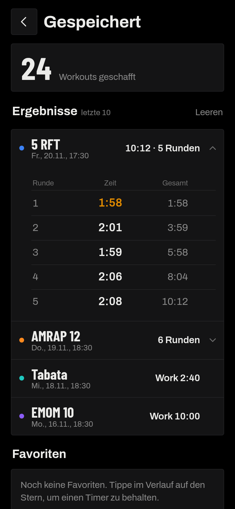
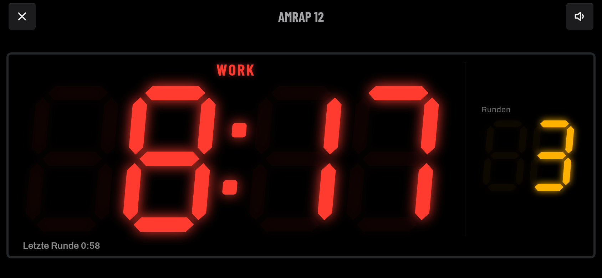
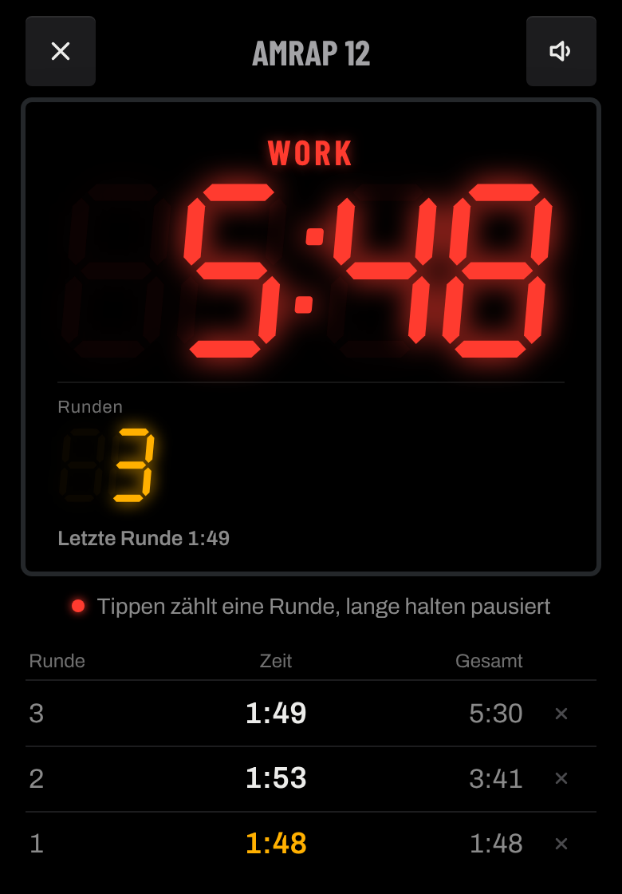
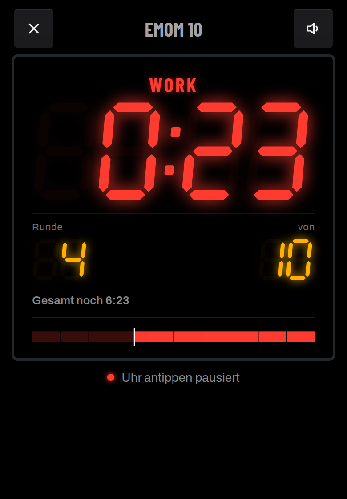
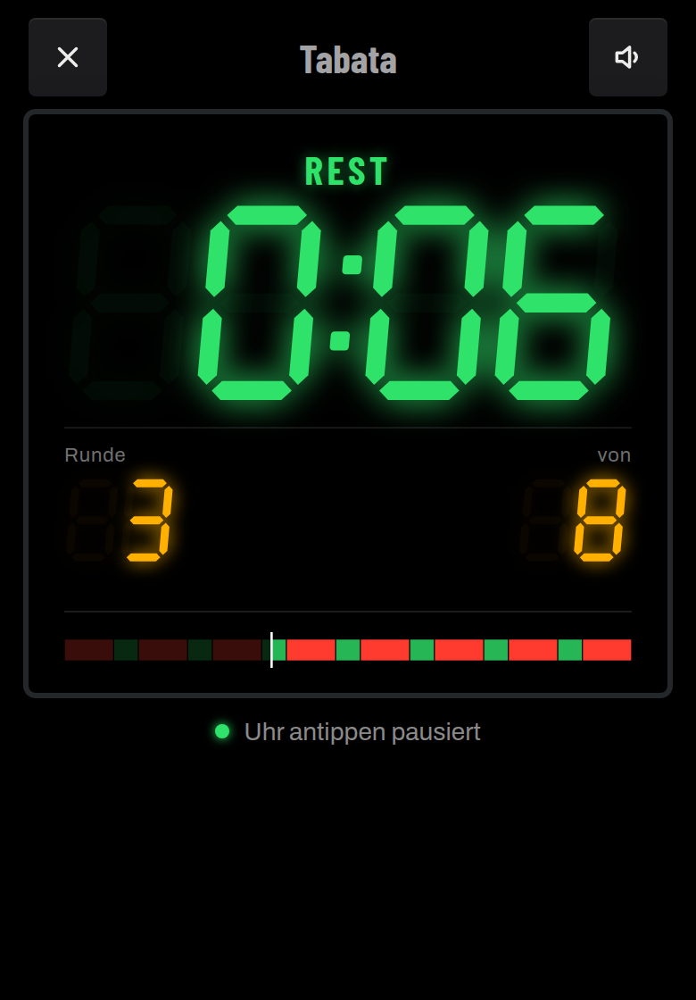

  

<h1 align="center">wod-clock</h1>

  Minimalistischer Workout-Timer für CrossFit und Functional Fitness. 
  For Time, AMRAP, EMOM und Tabata – im Look der LED-Wanduhr aus der Box.

  <b><a href="https://delis267.github.io/wod-clock/">→ Timer öffnen</a></b>

  
  &nbsp;
  
  &nbsp;
  

  

## Auf einen Blick

- **Vier Modi**: For Time, AMRAP, EMOM und Tabata, in wenigen Sekunden eingestellt
- **Große 7-Segment-Uhr**, hochkant und quer: Rot für Work, Grün für Rest, Bernstein für Runden
- **Runden per Tippen** auf die Uhr zählen, mit Zwischenzeit pro Runde
- **Ergebnis nach dem Workout** mit allen Rundenzeiten, die letzten 10 bleiben gespeichert
- **Box-Buzzer**, der über deine Musik läuft, ohne sie anzuhalten
- **Offline-fähig** und installierbar auf dem Home-Bildschirm, hell oder dunkel

## Die vier Modi

<table>
  <tr>
    <td width="190"></td>
    <td>
      <h3>For Time</h3>
      Die Uhr läuft hoch, bis du fertig bist. Tippen zählt eine Runde, die Liste zeigt jede Zwischenzeit,
      die schnellste Runde ist markiert. Optional mit Time Cap und Rundenziel (z. B. 5 RFT).
      Ohne Ziel beendest du mit „Fertig“, mit Bestätigung gegen versehentliches Tippen.
    </td>
  </tr>
  <tr>
    <td width="190"></td>
    <td>
      <h3>AMRAP</h3>
      So viele Runden wie möglich in fester Zeit. Die Uhr läuft herunter, Tippen zählt eine Runde.
      Dauer frei wählbar, optional mehrere Sätze mit Rest dazwischen.
    </td>
  </tr>
  <tr>
    <td width="190"></td>
    <td>
      <h3>EMOM</h3>
      Jede Runde startet im gewählten Intervall, was übrig bleibt, ist dein Rest.
      Auch als E2MOM, E3MOM und so weiter. Die Uhr zeigt Runde und verbleibende Gesamtzeit.
    </td>
  </tr>
  <tr>
    <td width="190"></td>
    <td>
      <h3>Tabata</h3>
      Work und Rest im Wechsel, Rot und Grün schon von weitem zu erkennen.
      Work, Rest, Runden und Sätze einstellbar, Standard ist klassisch 20/10 × 8.
    </td>
  </tr>
</table>

## Während des Workouts

- **Uhr antippen**
  - AMRAP / For Time: Tippen zählt eine Runde, lange halten pausiert
  - EMOM / Tabata und jeder Countdown: Tippen pausiert
- **Fehltipp?** Runde per × aus der Liste löschen, sie verschmilzt mit der nächsten
- **Ablauf-Leiste** unten in der Uhr: zeigt das ganze Workout wie beim Einstellen, Erledigtes gedimmt,
  ein Strich markiert, wo du stehst, getippte Runden erscheinen als Striche. Bei For Time mit Time Cap und
  Rundenziel ist der Cap gleichmäßig auf die Runden verteilt, so siehst du, ob du im Plan liegst
- **Box-Buzzer**, bewusst sparsam: 3-2-1 im Countdown vor dem Start, ein Ton bei jedem Wechsel zwischen Work und Rest,
  Buzzer am Ende, ein kurzer Klick beim Tippen einer Runde
- **Querformat**: Handy quer legen, die Uhr füllt den Bildschirm wie eine Wanduhr

## Nach dem Workout

- **Ergebnis** mit Zeit oder Runden und allen Rundenzeiten, bei mehreren Sätzen nach Satz gruppiert
- **Ergebnisse**: die letzten 10 fertigen Workouts mit Datum, Rundenzeiten zum Aufklappen.
  Abgebrochene Workouts werden nicht gespeichert.
- **Verlauf und Favoriten**: die letzten 10 Timer in CrossFit-Kurzschreibweise, mit einem Tipp wieder geladen
- **Workout-Zähler** für alle geschafften Workouts

## Auf dem Handy installieren

1. Link im Browser öffnen
2. **iPhone (Safari):** Teilen → „Zum Home-Bildschirm“
   **Android (Chrome):** Menü ⋮ → „App installieren“ bzw. „Zum Startbildschirm hinzufügen“
3. wod-clock vom Home-Bildschirm starten – dann im Vollbild ohne Browserleiste

Gut zu wissen: Wechselst du während eines Workouts kurz in eine andere App, läuft die Zeit korrekt weiter.
Signaltöne kommen in dieser Zeit aber nicht, denn iOS hält Web-Apps im Hintergrund an.

## Weitere Doku

- [Technik](docs/technik.md) – Aufbau, Projektstruktur, Veröffentlichen auf GitHub Pages, Screenshots
- [Tests](docs/tests.md) – Teststrategie und Beispiel

Die Screenshots in dieser README werden automatisch aus der echten App erzeugt und bleiben so immer aktuell.

## Lizenz

[MIT](LICENSE)
