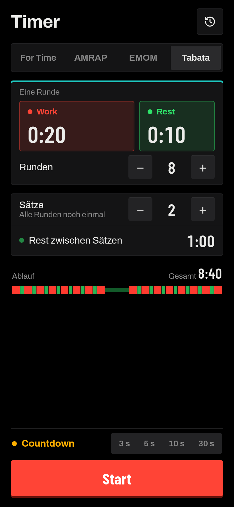
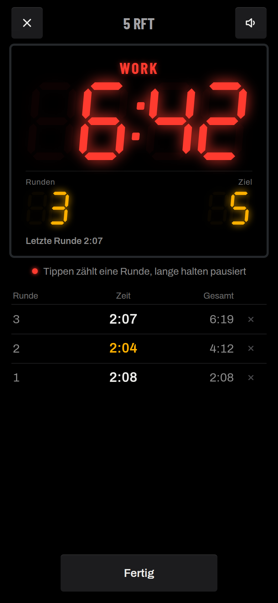

  

<h1 align="center">wod-clock</h1>

  Minimalistischer Workout-Timer für CrossFit und Functional Fitness. 
  For Time, AMRAP, EMOM und Tabata – im Look der LED-Wanduhr aus der Box.

  <b><a href="https://delis267.github.io/wod-clock/">→ Timer öffnen</a></b>

  
  &nbsp;
  

  

## Funktionen

- **Vier Modi**
  - **For Time** – Stoppuhr mit optionalem Time Cap und Rundenziel (z. B. 5 RFT), beenden mit „Fertig“
  - **AMRAP** – Dauer frei wählbar, optional mehrere Sätze mit Rest dazwischen
  - **EMOM** – jede Runde startet im gewählten Intervall (EMOM, E2MOM, E3MOM …)
  - **Tabata** – Work, Rest, Runden und Sätze; Standard ist klassisch 20/10 × 8
- **7-Segment-Wanduhr** hochkant und quer, WORK und REST groß in der Uhr, Rot für Work, Grün für Rest, Bernstein für Runden
- **Uhr antippen**
  - AMRAP / For Time: Tippen zählt eine Runde, lange halten pausiert
  - EMOM / Tabata und jeder Countdown: Tippen pausiert
  - Zwischenzeiten pro Runde, schnellste Runde markiert, Fehltipps per × aus der Liste löschen
  - nach dem Workout stehen die Rundenzeiten auch im Ergebnis
- **Box-Buzzer**: 3-2-1-Piepen, Buzzer bei Start und Ende, Doppelpiep 10 s vor Schluss; läuft über deine Musik, ohne sie anzuhalten
- **Gespeichert**: Workout-Zähler, Ergebnisse der letzten 10 fertigen Workouts (mit aufklappbaren Rundenzeiten), Favoriten und die letzten 10 Timer in CrossFit-Kurzschreibweise
- **Hell- und Dunkelmodus** (automatisch oder fest), läuft ohne Scrollen auf dem Handy
- **Offline-fähig** nach dem ersten Aufruf, installierbar auf dem Home-Bildschirm

## Auf dem Handy installieren

1. Link im Browser öffnen
2. **iPhone (Safari):** Teilen → „Zum Home-Bildschirm“
   **Android (Chrome):** Menü ⋮ → „App installieren“ bzw. „Zum Startbildschirm hinzufügen“
3. wod-clock vom Home-Bildschirm starten – dann im Vollbild ohne Browserleiste

Gut zu wissen: Wechselst du während eines Workouts kurz in eine andere App, läuft die Zeit korrekt weiter.
Signaltöne kommen in dieser Zeit aber nicht, denn iOS hält Web-Apps im Hintergrund an.

## Weitere Doku

- [Technik](docs/technik.md) – Aufbau, Projektstruktur, Veröffentlichen auf GitHub Pages
- [Tests](docs/tests.md) – Teststrategie und Beispiel

## Lizenz

[MIT](LICENSE)
